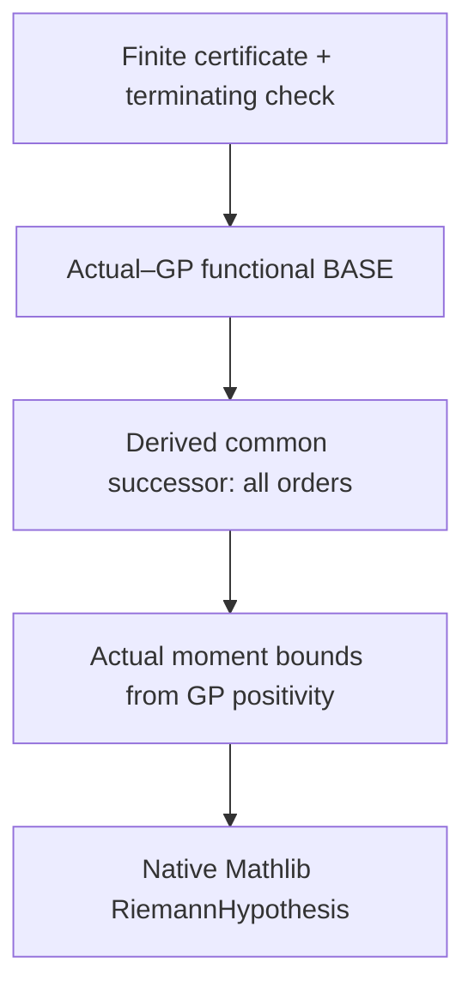

# Riemann-Hypothesis-Final

Lean 4.33 research toward a finite-witness reduction of the **actual Mathlib
Riemann hypothesis**, using SOLOBOLO, shared-spectrum Cayley–Sturm induction,
and a derived finite induction input.

**Status: `v0_1_0_construction`.** Repository sources prepared; native Lean
compilation pending. The actual-ξ finite base calibration and full RH reduction
remain open. No RH proof, complete accepted RH witness, or Lean-ready claim.

The intended chain is



The arrows involving actual-data calibration and the final analytic transfer
are open obligations; the diagram states the target route.

## Contents

| Location | Purpose |
|---|---|
| `RHFinal/Core/` | Raw finite SOS certificates, exact local checks, induction transfer |
| `RHFinal/Search.lean` | Terminating bounded local search; no RH admission |
| `FiniteWitness/` | Ten unchanged SOLOBOLO finite-spectrum and trace modules |
| `RHFinal/Actual/` | Actual ξ/native RH definitions, differential successor and open inputs |
| `RHFinal/GP/` | Literal Mellin–Hilbert objects, native ξ binding, KQ/GP/BKQR endpoints, GP7 and generic master extraction |
| `docs/GP_CONSTRUCTION.md` | GP layers, exact normalizations, source scope and remaining finite-input obligations |
| [`RH-Equivalences/`](RH-Equivalences/README.md) | 41 native-target RH formulations, 10 separate model formulations, exact source bodies and newer local criteria |
| `docs/FRONTIER.md` | Ordered analytic and finite-reduction work plan |
| `docs/SOURCE_AUDIT.md`, `docs/SOLOBOLO_AUDIT.md` | Source scope and unresolved assumptions |
| `provenance/` | SHA-256 input inventory and unchanged-import manifests |
| `research/upstream/` | Preserved historical sources, outside the default build |

## Native Windows workflow

Use the installed native Windows Lean 4.33.0. The runner makes no downloads
and does not invoke Python, PowerShell, WSL or Lake setup.

```cmd
run.cmd core
```

To include the Mathlib-dependent SOLOBOLO sources, integrated GP construction
and actual-data interfaces:

```cmd
set "RH_MATHLIB_ROOT=C:\path\to\cached\mathlib"
run.cmd full
```

The runner hashes inputs, compiles changed/invalidated modules, checks printed
axiom dependencies, and writes native pass receipts. Cached project objects
are reused only when their provenance matches. See [build details](docs/BUILD.md).
No imported historical object is admitted as a verified `LEAN_ANCHORINGS`
checkpoint. The first native run is required.

Run the bounded local search after compiling/auditing its imports:

```cmd
run.cmd search
```

Follow [core details](docs/CORE.md) for its limited template and exact scope.
An accepted local diagnostic is never labelled an RH witness.

## GP integration

The recovered KQ/GP/BKQR construction is included with actual ξ calculus and
Widder/Cayley interfaces, together with the literal Mellin–Hilbert definitions,
the separate GP7 weight-seven module family, and the generic master energy
induction. [GP construction details](docs/GP_CONSTRUCTION.md) distinguish these
normalizations and their remaining hypotheses. No imported model or finite
local diagnostic is claimed to be an actual-ξ witness. This integration is
tracked by Git revision; `v0_1_0_construction` remains unchanged.

## Proof discipline

Witnesses contain finite raw data. Global analytic hypotheses remain named,
visible open propositions outside the witnesses. Each theorem's scope and its
compilation/axiom status are tracked separately. In particular, a derived
algebraic successor does not establish positivity or the induction BASE.

The workflow definition is [YOU_ARE_GOODWORKFLOWFRONTIER
v1_0_15](docs/YOU_ARE_GOODWORKFLOWFRONTIER_v1_0_15.txt). Construction follows
`A_TIER_PLANNING` and `A_TIER_EXECUTION`, with proof tiers awarded only after
their stated gates. The exact final goal includes both checker soundness and
RH-to-witness completeness.

Source imports retain provenance. No license grant has been added.

The user-created public repository is
[`randogelist/Riemann-Hypothesis-Final`](https://github.com/randogelist/Riemann-Hypothesis-Final).
These research sources include the GP integration. See
[clone and update instructions](docs/PUBLISH.md); repository publication does
not certify a native Lean build.
